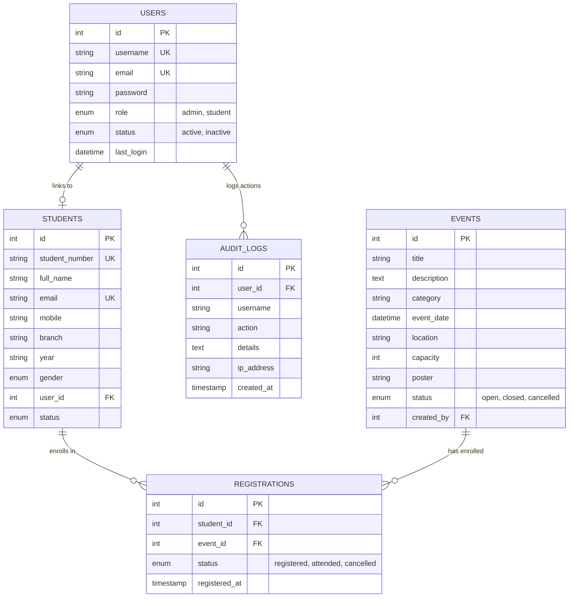

# StudentHub - University Campus & Academic Portal
**Course**: Web Development Frameworks (ITUE203) &bull; Semester 3 (Odd 2026-27)  
**Institution**: Charotar University of Science and Technology (CHARUSAT)  
**Faculty**: Faculty of Technology and Engineering (FTE)  
**Full-Stack Implementation**: Practicals 1 through 15 Complete

---

## 📖 Project Overview

**StudentHub** is an integrated full-stack web application developed for academic management, student tracking, event registration, and administrative monitoring. The project implements modern web development best practices: semantic HTML5 accessibility, responsive mobile-first design (CSS Grid & Flexbox), client-side interactivity and validation (Fetch API, DOM manipulation, Canvas CAPTCHA), secure server-side processing (PHP 8+, Bcrypt, CSRF prevention, session timeout), RESTful JSON APIs, MySQL relational database management, and role-based access control (RBAC).

---

## 🚀 Key Features by Practical Module

| Practical | Module Title | Core Technologies | Implementation & Files |
|:---:|:---|:---|:---|
| **PR-01** | Project Initiation, Requirements, Sitemap, Wireframe & GitHub Setup | Git, Markdown, Wireframes | `README.md`, `wdflab/image/wire1.png-wire10.png`, `.git` |
| **PR-02** | Semantic HTML5 Pages with Accessibility-Ready Structure | HTML5, WAI-ARIA, Skip Links | `includes/header.php`, `about.php`, `profile.php`, `index.php` |
| **PR-03** | Responsive UI Design using CSS Grid, Flexbox & Mobile-First | CSS3, Media Queries, Dark Mode | `css/style.css` (Grid layouts, CSS variables) |
| **PR-04** | JavaScript DOM Manipulation, Event Handling & UI Interactivity | Vanilla JS, LocalStorage, Modal | `js/main.js` (Theme toggle, drawer menu, modal, accordion) |
| **PR-05** | Registration Form with Frontend Regex Validation & Errors | HTML Forms, Regex, Canvas CAPTCHA | `register.php`, `js/validation.js`, password strength meter |
| **PR-06** | Rendering External JSON Data using Fetch API, Search & Filter | Fetch API, JSON, Pagination | `faqs.php`, `js/dynamic-lists.js`, `data/faqs.json` (16 records) |
| **PR-07** | PHP Form Processing with Server-Side Validation & File Storage | PHP, JSON, CSV, `flock()` | `contact.php`, `contact-process.php`, `view-submissions.php` |
| **PR-08** | MySQL Schema Design, ER Model, Connectivity & Prepared Statements | MySQLi, PDO, Prepared Stmts | `sql/studenthub.sql`, `db.php`, `db_pdo.php`, `test_connection.php` |
| **PR-09** | Secure User Registration with DB Insert, Duplicate Check & Hashing | Bcrypt, Prepared Stmts | `register.php`, duplicate check, transaction safety |
| **PR-10** | Secure Login/Logout with Sessions, RBAC, Timeout & Remember-Me | Sessions, Timeout, Cookies | `login.php`, `logout.php`, `includes/auth.php` (15m inactivity) |
| **PR-11** | Student Management CRUD with Search, Filter & CSV Export | MySQLi CRUD, Pagination, CSV | `students.php`, `student-add.php`, `student-edit.php`, `student-delete.php` |
| **PR-12** | Event Management CRUD with Poster Upload & File Validation | File Upload, MIME Check, Hash | `events.php`, `event-add.php`, `event-edit.php`, `uploads/events/` |
| **PR-13** | PHP JSON API & AJAX/Fetch-Based CRUD without Page Reload | REST API, Fetch API, Debounce | `api/events.php`, `events-ajax.php` (Zero reload SPA) |
| **PR-14** | Admin Dashboard with RBAC, Dynamic Menu & Audit Log | Aggregation, RBAC, Traceability | `admin/dashboard.php`, `admin/audit-logs.php`, `admin/users.php` |
| **PR-15** | Final Integration, Testing, Documentation & Git Submission | Full Integration & Testing | Master integrated portal, schema seed, testing guide |

---

## 🛠️ Technology Stack & Requirements

- **Server Environment**: Apache 2.4+ (XAMPP recommended)
- **Programming Language**: PHP 8.0+ (`strict_types=1`, `session`, `mysqli`, `pdo_mysql`, `fileinfo`)
- **Database**: MySQL 8.0+ / MariaDB 10.4+ (InnoDB engine, utf8mb4 collation)
- **Frontend Stack**: Modern Semantic HTML5, CSS3 (Grid & Flexbox, CSS Variables), Vanilla JavaScript ES6+
- **Version Control**: Git & GitHub

---

## 🗄️ Database Architecture & Setup

### Database Name: `studenthub`
The database schema is fully normalized and located in `sql/studenthub.sql`.



### Installation Steps:
1. Ensure **Apache** and **MySQL** are running in your XAMPP Control Panel.
2. Open **phpMyAdmin** (`http://localhost/phpmyadmin/`) or MySQL terminal.
3. Import the schema and seed file:
   ```bash
   mysql -u root -p studenthub < c:\xampp\htdocs\studenthub\sql\studenthub.sql
   ```
4. Verify database connectivity by navigating to:
   ```
   http://localhost/studenthub/test_connection.php
   ```

---

## 🔑 Default Seed Credentials (for Testing & Viva)

| Role | Username | Email | Password | Access Level |
|:---|:---|:---|:---|:---|
| **Administrator** | `admin` | `admin@charusat.edu.in` | `Admin@123` | Full CRUD, Admin Panel, Audit Logs, User Status Toggle |
| **Student** | `aarav` | `aarav.patel@charusat.edu.in` | `Student@123` | Student Profile, Event Registration, FAQs, Feedback |
| **Student** | `diya` | `diya.sharma@charusat.edu.in` | `Student@123` | Student Profile, Event Registration, FAQs, Feedback |

---

## 🧭 Navigation & Page Directory

- **Landing Home**: `index.php`
- **About Portal**: `about.php`
- **Campus Events Catalog**: `events.php`
- **Asynchronous AJAX Event CRUD (PR-13)**: `events-ajax.php`
- **Student Directory CRUD (PR-11)**: `students.php`
- **Add Student Record**: `student-add.php`
- **Export Students CSV**: `student-export.php`
- **Student Profile**: `profile.php`
- **FAQs Explorer (Fetch API - PR-06)**: `faqs.php`
- **Contact & File Storage (PR-07)**: `contact.php`
- **Stored Submissions Viewer (JSON & CSV)**: `view-submissions.php`
- **Feedback Form**: `feedback.php`
- **User Registration (PR-05 & PR-09)**: `register.php`
- **User Login (PR-10)**: `login.php`
- **User Logout**: `logout.php`
- **Admin Dashboard (PR-14)**: `admin/dashboard.php`
- **Audit Logs Explorer (PR-14)**: `admin/audit-logs.php`
- **Manage Users & Status Toggle (PR-14)**: `admin/users.php`
- **RESTful JSON API Endpoint (PR-13)**: `api/events.php`
- **Database Status Checker (PR-08)**: `test_connection.php`

---

## 💡 Key Analysis & Answers to Syllabus Questions

### 1. What is URL and parts of URL?
A Uniform Resource Locator (URL) specifies the address of a web resource. Its parts are:
- **Scheme / Protocol**: `http://` or `https://`
- **Host / Domain**: `localhost` or `charusat.edu.in`
- **Port**: `:80` (HTTP) or `:443` (HTTPS)
- **Path**: `/studenthub/events.php`
- **Query String**: `?category=Technical&search=hackathon`
- **Fragment / Hash**: `#main-content`

### 2. How is an HTML file processed in a web browser?
1. **Network & Parsing**: The browser fetches HTML bytes, converts them into tokens, and constructs the **DOM (Document Object Model)** tree.
2. **CSSOM Construction**: CSS stylesheets are parsed to build the **CSSOM (CSS Object Model)** tree.
3. **Render Tree Generation**: DOM and CSSOM combine into a Render Tree containing only visible nodes.
4. **Layout (Reflow)**: Browser calculates exact geometries, widths, and coordinates of elements.
5. **Painting**: Pixels are rasterized to the screen. JavaScript can dynamically manipulate the DOM and trigger reflow/repaint.

### 3. How is page navigation flow managed?
Centralized header (`includes/header.php`) dynamically renders accessible navigation links based on user session role (`guest`, `student`, or `admin`), backed by `includes/auth.php` access guards.

### 4. How are Git commits maintained after each practical?
Each practical milestone is tracked with atomic, descriptive commits following conventional commit standards (e.g. `feat(pr-11): implement student CRUD with search, filter and CSV export`).

---

## 🛡️ Security Implementation Matrix

- **Password Hashing**: Industry-standard Bcrypt (`PASSWORD_BCRYPT` with cost factor 10) preventing plain-text exposure.
- **SQL Injection Prevention**: 100% prepared statements (`$stmt->bind_param` and PDO `execute`) across all user-supplied queries.
- **CSRF Defense**: Cryptographic per-session CSRF tokens validated on all state-altering POST requests.
- **Session Security**:
  - `session_regenerate_id(true)` upon login preventing session fixation.
  - `httponly` and `samesite=Lax` cookie flags mitigating XSS cookie theft.
  - 15-minute inactivity timeout automatically terminating orphaned sessions.
- **File Upload Security**:
  - Strict MIME validation (`finfo(FILEINFO_MIME_TYPE)`).
  - Maximum 2MB size cap.
  - Randomized filename generation (`bin2hex(random_bytes(10))`).
  - `.htaccess` script execution prevention in upload directories.
- **Audit Logging**: Comprehensive traceability in `audit_logs` recording logins, student operations, event creations, and IP addresses.
